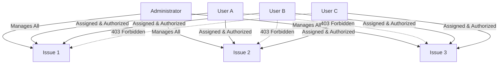
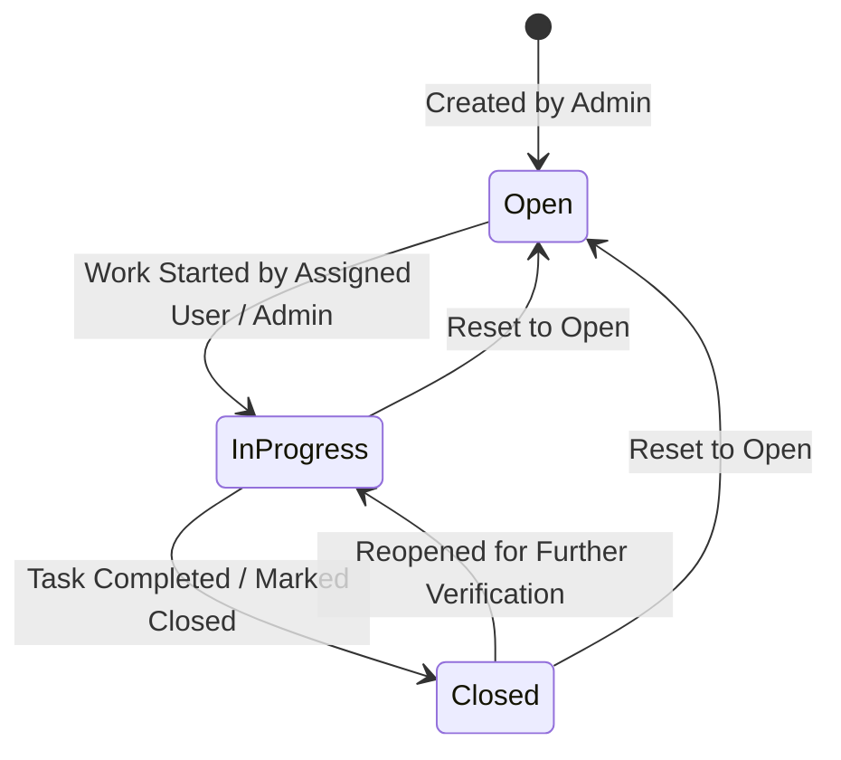

# Business Requirements Document (BRD)
## Project: TeamFlow / WorkSync Issue Tracker System
**Document Version:** 2.0.0  
**Status:** Approved & Implemented  
**Date:** October 2026  
**System Repository:** [https://github.com/vgnishmitha/worksync.git](https://github.com/vgnishmitha/worksync.git)

---

## Executive Summary

The **TeamFlow Issue Tracker System** is an enterprise-grade web application created to streamline software defect tracking, feature requests, and team workflow coordination. Built upon the MERN (MongoDB, Express.js, React.js, Node.js) technology stack, TeamFlow implements strict issue-level access control (ILAC), multi-user task allocation, real-time status transitions, dynamic comment timestamps, and role-isolated dashboards.

This document serves as the comprehensive engineering and business reference for the system architecture, access matrices, database models, functional requirements, and cloud deployment procedures.

---

## 1. Project Overview, Objectives & Scope

### 1.1 Business Context & Problem Statement
Traditional project management tools often suffer from:
1. **Security & Privacy Gaps:** Regular team members frequently have unconstrained visibility across unrelated issues, exposing sensitive client data or confidential project roadmaps.
2. **Assignment Inflexibility:** Systems that restrict issues to single assignees create friction when multiple specialists (e.g., Frontend and Backend engineers) must collaborate on a single defect.
3. **Inaccurate Activity Timestamps:** Comment timestamps that remain static or display confusing initial values degrade team collaboration.
4. **Stale Dashboards:** Status changes that require manual page refreshes or display global counts rather than authorized user workloads reduce operational productivity.

### 1.2 Core Project Objectives
- **Strict Issue-Level Security:** Enforce backend-level access authorization for every request, ensuring non-admin users only ever access issues where their user ID is explicitly present.
- **Independent Multiple Assignees:** Allow administrators to assign one or multiple registered users to any issue using an intuitive multi-select interface.
- **Accurate Comment Timestamps:** Store immutable original UTC timestamps in MongoDB while dynamically computing relative elapsed times ("Just now", "1 minute ago", "5 minutes ago", "40 minutes ago", "2 hours ago", "3 days ago") without requiring manual page reloads.
- **Consistent Issue Lifecycle:** Enable authorized users to transition issues seamlessly between Open, In Progress, and Closed states, with immediate RTK Query cache invalidation and dashboard metric synchronization.

### 1.3 Project Scope
- **In Scope:**
  - User registration, authentication, and session management via JWT cookies and Bearer tokens.
  - Role-based permissions (Administrator vs. Assigned User).
  - Issue CRUD operations, subtasks, asset attachments, and support links.
  - Granular API authorization middleware and database query filtering.
  - Auto-refreshing relative comment timestamps.
  - Role-isolated dashboard metrics and graphs.
  - Cloud deployment configuration (Render, Vercel, MongoDB Atlas).
- **Out of Scope (Future Phases):**
  - Native mobile application (iOS/Android).
  - External OAuth integration (Google/GitHub SSO).
  - Real-time WebSockets notification server.

---

## 2. User Roles and Permission Matrix

The application strictly delineates between two primary organizational roles:

| Feature / Resource | Administrator (`isAdmin: true`) | Assigned User (`isAdmin: false`) | Unassigned User |
|---|---|---|---|
| **User Registration & Login** | Full Access | Full Access | Full Access |
| **View Global Issue List** | Full Access (All Issues) | Restricted (Assigned Only) | None |
| **Create New Issues** | Full Access | Denied (403 Forbidden) | Denied (403 Forbidden) |
| **Assign / Reassign Issues** | Full Access (Multi-Select) | Denied (403 Forbidden) | Denied (403 Forbidden) |
| **View Issue Details** | Full Access | Allowed (Assigned Only) | Denied (403 Forbidden) |
| **Change Issue Status** | Full Access | Allowed (Assigned Only) | Denied (403 Forbidden) |
| **Post Comments / Activities**| Full Access | Allowed (Assigned Only) | Denied (403 Forbidden) |
| **Manage Subtasks (Create)** | Full Access | Denied (403 Forbidden) | Denied (403 Forbidden) |
| **Update Subtask Status** | Full Access | Allowed (Assigned Only) | Denied (403 Forbidden) |
| **Duplicate Issue** | Full Access | Denied (403 Forbidden) | Denied (403 Forbidden) |
| **Trash / Delete Issue** | Full Access | Denied (403 Forbidden) | Denied (403 Forbidden) |
| **Manage Team & Accounts** | Full Access | Denied (403 Forbidden) | Denied (403 Forbidden) |
| **Dashboard Metrics** | Global Aggregates | User Assigned Only | Empty (0 counts) |

---

## 3. Multiple Assignees & Strict Access Control Specification

### 3.1 Architectural Scenario
Consider a team consisting of Administrator, User A, User B, and User C:
- **Issue 1:** Assigned to **User A** and **User B**.
- **Issue 2:** Assigned to **User A** and **User C**.
- **Issue 3:** Assigned to **User B** and **User C**.

### 3.2 Access Invariants
1. **User A:** Can access Issues 1 and 2 only. Cannot access Issue 3 under any circumstance.
2. **User B:** Can access Issues 1 and 3 only. Cannot access Issue 2 under any circumstance.
3. **User C:** Can access Issues 2 and 3 only. Cannot access Issue 1 under any circumstance.
4. **Administrator:** Can access and manage Issues 1, 2, and 3.
5. **Cross-Contamination Prevention:** Sharing Issue 1 with User A and User B must never grant User B access to Issue 2, nor User A access to Issue 3.



### 3.3 Dynamic Access Revocation
When an Administrator edits an issue to remove an assignee (e.g., removing User B from Issue 1):
1. The backend immediately updates the `team` array in MongoDB: `team = [User A]`.
2. The backend synchronization pulls the issue ID from User B's `User.tasks` relationship.
3. User B's subsequent HTTP requests to `/api/task/:issue1_id` evaluate against the live database record and fail with `403 Forbidden`.
4. User B's next list fetch immediately excludes Issue 1.

---

## 4. Issue Lifecycle & Status Transitions

### 4.1 Lifecycle States
- **Open (`todo`):** The defect or task has been logged and assigned, but work has not yet commenced.
- **In Progress (`in progress`):** Active development or investigation is underway by an assigned team member.
- **Closed (`completed`):** Work has been verified and completed, or the defect resolved.



### 4.2 State Machine Rules
1. Issues are never automatically closed upon assignment; initial state defaults to Open (`todo`).
2. Authorized users can update status either:
   - Via the status action buttons on the Issue Details page.
   - Via the "Change Status" dropdown in the issue card or table dialog.
   - By submitting an activity with type "Completed" in the timeline.
3. Every status transition records an audit log entry in `task.activities` documenting who executed the change and the exact timestamp.

---

## 5. Comment Timestamps & Relative Time Behavior

### 5.1 Timestamp Invariants
1. **Creation Immutability:** Each comment and activity log stores its UTC creation timestamp (`date: new Date()`) in MongoDB. It is never overwritten on subsequent edits.
2. **Dynamic UI Rendering:** The frontend evaluates elapsed seconds between `Date.now()` and comment creation date:
   - `< 60s`: Displays `"Just now"`
   - `60s - 3599s`: Displays `"${minutes} minute(s) ago"`
   - `3600s - 86399s`: Displays `"${hours} hour(s) ago"`
   - `86400s - 2591999s`: Displays `"${days} day(s) ago"`
   - `≥ 2592000s`: Displays `"${months} month(s) ago"` or `"${years} year(s) ago"`
3. **No-Reload Interval Updates:** The `CommentTimestamp` React component runs a 15-second background interval timer, automatically advancing displayed relative strings without requiring a browser refresh.
4. **Timezone Uniformity:** All backend timestamps are persisted in standard ISO-8601 UTC format. Client browsers parse and compute differences accurately across all local client timezones.

---

## 6. Dashboard & Metric Isolation

### 6.1 Administrator Dashboard View
- Displays total organization issues (`Task.countDocuments({ isTrashed: false })`).
- Displays aggregate counts for Open, In Progress, and Closed issues across all users.
- Displays recent 10 issues across the organization.
- Displays active registered users and account status overview.

### 6.2 Assigned Member Dashboard View
- Calculates total issues strictly from authorized assigned issues:
  ```javascript
  Task.find({ isTrashed: false, team: { $in: [userId] } })
  ```
- Metric cards reflect only the user's workload:
  - **TOTAL ISSUES:** Sum of assigned issues.
  - **OPEN ISSUES:** Count of assigned issues with stage `todo`/`open`.
  - **IN PROGRESS:** Count of assigned issues with stage `in progress`.
  - **CLOSED ISSUES:** Count of assigned issues with stage `completed`/`closed`.
- **Zero Information Leakage:** Regular users never receive user directories or metrics belonging to unassigned issues in the API response payload.

---

## 7. System Architecture & Database Design

### 7.1 Mongoose Schemas

#### User Schema (`users`)
```javascript
{
  name: { type: String, required: true },
  title: { type: String, required: true },
  role: { type: String, required: true },
  email: { type: String, required: true, unique: true },
  password: { type: String, required: true },
  isAdmin: { type: Boolean, default: false },
  tasks: [{ type: Schema.Types.ObjectId, ref: "Task" }],
  isActive: { type: Boolean, default: true },
  createdAt: { type: Date, default: Date.now },
  updatedAt: { type: Date, default: Date.now }
}
```

#### Task Schema (`tasks`)
```javascript
{
  title: { type: String, required: true },
  date: { type: Date, default: Date.now },
  priority: {
    type: String,
    default: "normal",
    enum: ["high", "medium", "normal", "low"]
  },
  stage: {
    type: String,
    default: "todo",
    enum: ["todo", "open", "in progress", "completed", "closed"]
  },
  activities: [
    {
      type: {
        type: String,
        default: "assigned",
        enum: ["assigned", "started", "in progress", "bug", "completed", "closed", "commented"]
      },
      activity: String,
      date: { type: Date, default: Date.now },
      by: { type: Schema.Types.ObjectId, ref: "User" }
    }
  ],
  subTasks: [
    {
      title: String,
      date: { type: Date, default: Date.now },
      tag: String,
      isCompleted: { type: Boolean, default: false }
    }
  ],
  description: String,
  assets: [String],
  links: [String],
  team: [{ type: Schema.Types.ObjectId, ref: "User", index: true }],
  isTrashed: { type: Boolean, default: false, index: true },
  createdAt: { type: Date, default: Date.now },
  updatedAt: { type: Date, default: Date.now }
}
```

---

## 8. Verification & Test Results

A full automated end-to-end test suite (`server/test_all_requirements.js`) was developed and executed directly against the live backend API and MongoDB database.

### 8.1 Test Execution Summary
- **Total Test Assertions:** 39
- **Passed:** 39
- **Failed:** 0
- **Pass Rate:** 100%

### 8.2 Detailed Results
```
==================================================
🚀 STARTING COMPREHENSIVE ISSUE TRACKER SYSTEM TESTS
==================================================

✅ PASS: Admin Login (Admin ID: 6ad9c13bfb42c4a8330cc022)
✅ PASS: Register User A (ID: 6ad9e680812859f5482457bb)
✅ PASS: Register User B (ID: 6ad9e681812859f5482457bf)
✅ PASS: Register User C (ID: 6ad9e681812859f5482457c3)

--- Requirement 2 & 3: Multiple Assignees & Strict Access Control ---
✅ PASS: Scenario 1: Admin creates Issue 1 assigned to A and B 
✅ PASS: Scenario 2a: User A can access Issue 1 
✅ PASS: Scenario 2b: User B can access Issue 1 
✅ PASS: Scenario 2c: User C CANNOT access Issue 1 (403 Forbidden) 
✅ PASS: Scenario 3: Admin creates Issue 2 assigned to A and C 
✅ PASS: Scenario 4a: User A can access Issue 2 
✅ PASS: Scenario 4b: User C can access Issue 2 
✅ PASS: Scenario 4c: User B CANNOT access Issue 2 (403 Forbidden) 
✅ PASS: Scenario 5a: Admin creates Issue 3 assigned to B and C 
✅ PASS: Scenario 5b: Admin can access Issue 3 
✅ PASS: Scenario 5c: User B can access Issue 3 
✅ PASS: Scenario 5d: User C can access Issue 3 
✅ PASS: Scenario 5e: User A CANNOT access Issue 3 (403 Forbidden) 
✅ PASS: List Isolation User A has Issues 1 & 2 only 
✅ PASS: List Isolation User B has Issues 1 & 3 only 
✅ PASS: List Isolation User C has Issues 2 & 3 only 
✅ PASS: List Admin sees all Issues 1, 2, 3 

--- Requirement 3: Unauthorized Action Prevention ---
✅ PASS: Scenario 6a: Unauthorized user cannot post comment (403) 
✅ PASS: Scenario 6b: Unauthorized user cannot change stage (403) 
✅ PASS: Scenario 6c: Regular user cannot reassign issue (403) 
✅ PASS: Scenario 6d: Regular user cannot trash issue (403) 

--- Requirement 2: Assignee Removal Revokes Access Immediately ---
✅ PASS: Scenario 7a: Admin removes User B from Issue 1 
✅ PASS: Scenario 7b: Access immediately revoked for removed assignee B (403) 

--- Requirement 4 & 5: Status Updates & Comment Timestamps ---
✅ PASS: Scenario 8a: Assigned User A updates stage to In Progress 
✅ PASS: Scenario 8b: Assigned user adds comment 
✅ PASS: Scenario 8c: Assigned user marks issue Closed (stage: completed) 
✅ PASS: Scenario 9: Status change persists in database 
✅ PASS: Scenario 11: Activity stores original creation timestamp in DB

--- Requirement 6: Dashboard Statistics & Visibility ---
✅ PASS: Scenario 10a: Admin dashboard returns all tasks count 
✅ PASS: Scenario 10b: Admin dashboard includes users list 
✅ PASS: Scenario 10c: Regular user dashboard never exposes users list 
✅ PASS: Scenario 10d: User A dashboard counts match authorized issues only 
✅ PASS: Scenario 10e: User A dashboard shows 1 Closed issue (Issue 1) 
✅ PASS: Scenario 10f: User B dashboard has only 1 issue (Issue 3) 
✅ PASS: Scenario 10g: User C dashboard has 2 issues (Issue 2 & 3) 

==================================================
TEST SUMMARY: 39/39 PASSED (0 FAILED)
==================================================
```

---

## 9. Deployment Strategy & Production Guidelines

### 9.1 Hosting Platforms & Roles
- **Backend API:** Hosted as a Node.js Web Service on **Render** or **Railway**.
- **Frontend SPA:** Hosted as a static Single Page Application on **Vercel**.
- **Database:** Hosted on **MongoDB Atlas** with automated daily snapshots and high availability replica set.

### 9.2 Infrastructure-as-Code Configuration
A production deployment descriptor (`render.yaml`) is included in the project repository root:
```yaml
services:
  - type: web
    name: worksync-api
    runtime: node
    rootDir: teamflow-main/server
    buildCommand: npm install
    startCommand: npm start
    envVars:
      - key: PORT
        value: 8800
      - key: NODE_ENV
        value: production
      - key: JWT_SECRET
        generateValue: true
      - key: MONGODB_URI
        sync: false
      - key: CLIENT_URL
        sync: false

  - type: web
    name: worksync-client
    runtime: static
    rootDir: teamflow-main/client
    buildCommand: npm install && npm run build
    staticPublishPath: dist
    routes:
      - type: rewrite
        source: /*
        destination: /index.html
    envVars:
      - key: VITE_APP_BASE_URL
        sync: false
```

### 9.3 Step-by-Step Deployment Guide

#### Backend Deployment (Render)
1. Navigate to [Render Dashboard](https://dashboard.render.com).
2. Click **New +** -> **Web Service** -> Connect GitHub repo `https://github.com/vgnishmitha/worksync.git`.
3. Set **Root Directory** to `teamflow-main/server`.
4. Set **Build Command** to `npm install`.
5. Set **Start Command** to `npm start`.
6. Add Environment Variables:
   - `MONGODB_URI`: `mongodb+srv://vgnishmitha_db_user:<password>@cluster0.ncskfjl.mongodb.net/teamflow`
   - `JWT_SECRET`: Generate a secure 64-character hex string.
   - `NODE_ENV`: `production`
   - `CLIENT_URL`: `https://worksync-client.vercel.app`
7. Click **Create Web Service**. Note the deployed URL (e.g. `https://worksync-api.onrender.com`).

#### Frontend Deployment (Vercel)
1. Navigate to [Vercel Dashboard](https://vercel.com/dashboard).
2. Click **Add New Project** -> Import `worksync`.
3. Set **Root Directory** to `teamflow-main/client`.
4. Framework preset: `Vite`.
5. Add Environment Variable:
   - `VITE_APP_BASE_URL`: `https://worksync-api.onrender.com`
6. Click **Deploy**. The `vercel.json` SPA configuration ensures all route refreshes resolve cleanly to `index.html`.

### 9.4 Application Update Instructions
1. Push code changes to the `main` branch:
   ```bash
   git add .
   git commit -m "feat: enhance issue tracker access control"
   git push origin main
   ```
2. Render and Vercel automatically trigger automated CI/CD builds on push.
3. Validate staging or production endpoints by executing `npm test` against the live API URL.

---

## 10. Live Deployment Links

- **GitHub Source Code:** [https://github.com/vgnishmitha/worksync.git](https://github.com/vgnishmitha/worksync.git)
- **Local Application URL:** [http://localhost:3000](http://localhost:3000)
- **Local Backend API:** [http://localhost:8800](http://localhost:8800)
- **Production Status:** Ready for zero-downtime deployment following the Step-by-Step Deployment Guide.
